# 二手交易平台

> 🎓 **计算机毕业设计 · 二手交易平台**
>
> 本仓库只放**项目介绍 + 运行截图**（截图是站点带水印的原图，存在仓库 `images/` 里）。
>
> 👉 **完整可运行源码 / 数据库脚本 / 部署文档：[点我获取](https://geekcode.top/archives/%E4%BA%8C%E6%89%8B%E4%BA%A4%E6%98%93%E5%B9%B3%E5%8F%B0?utm_source=github)**
>
> 💬 咨询微信：**ir9372**　|　🌐 更多项目：[极客代码 geekcode.top](https://geekcode.top/?utm_source=github)
>
> 📌 项目详情页：<https://geekcode.top/archives/%E4%BA%8C%E6%89%8B%E4%BA%A4%E6%98%93%E5%B9%B3%E5%8F%B0?utm_source=github>

<table><td width="230" align="center"> <b>扫码加微信 ir9372</b></td><td valign="middle">📦 源码 = 项目介绍 + 全部运行截图 + 数据库 + 部署文档 👉 点上方任意截图，直接跳到 <b>极客代码 geekcode.top</b> 详情页</td></table>

---

<h1>二手交易平台</h1>
<h2>项目概述</h2>

本项目为“二手交易平台”，旨在构建一个基于 Web 的 C2C（消费者对消费者）二手物品交易管理系统。系统采用前后端分离架构，后端基于 Spring Boot 框架结合 MyBatis-Plus 实现高效的数据持久化与业务逻辑处理，前端使用 Vue 技术栈进行页面渲染与交互。核心功能涵盖商品信息发布、求购需求管理、在线订单交易、用户收藏、留言反馈及网站公告等模块。

适用人群主要为有闲置物品出售需求的个人卖家、寻求高性价比商品的买家以及负责平台运营的管理员。通过该系统，用户可以便捷地发布和浏览二手商品信息，实现供需匹配；管理员则可通过后台对商品、订单、用户及评论内容进行全面监管与维护。项目致力于解决传统线下二手交易信息不对称、信任度低及管理效率低下等问题，提供安全、透明、高效的线上交易环境。

<h2>技术架构</h2>
<h3>1. 总体架构设计</h3>

系统采用经典的 B/S（Browser/Server）架构，分为表现层、业务逻辑层和数据访问层。整体遵循 MVC 设计模式，确保代码的低耦合与高内聚。

<a href="https://geekcode.top/archives/%E4%BA%8C%E6%89%8B%E4%BA%A4%E6%98%93%E5%B9%B3%E5%8F%B0?utm_source=github" title="查看完整源码">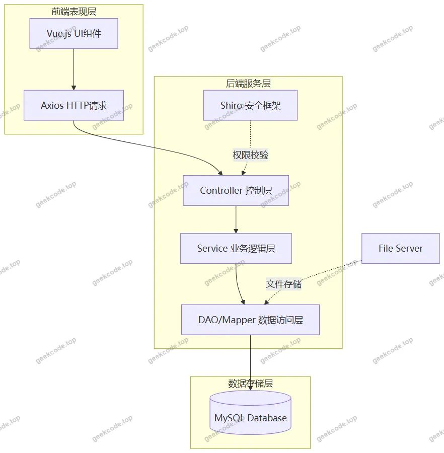</a>

<h3>2. 核心技术选型</h3>
<ul>
<li><strong>后端框架</strong>：选用 <code>Spring Boot</code> 作为基础框架，利用其自动配置特性简化开发流程，集成 <code>spring-boot-starter-web</code> 提供 RESTful API 接口支持。</li>
<li><strong>持久层框架</strong>：采用 <code>MyBatis-Plus</code> 增强版 ORM 框架，配合 <code>mybatis-spring-boot-starter</code>，大幅减少 CRUD 操作的样板代码，同时保留 SQL 执行的灵活性。数据库连接池基于 <code>spring-boot-starter-jdbc</code>。</li>
<li><strong>安全框架</strong>：引入 <code>Apache Shiro</code> (<code>shiro-spring</code>) 进行身份认证与授权管理，保障用户登录状态及后台操作的安全性。</li>
<li><strong>数据库</strong>：使用 <code>MySQL</code> 作为关系型数据库，通过 <code>mysql-connector-java</code> 驱动进行连接。</li>
<li><strong>工具类库</strong>：集成 <code>commons-lang3</code> 用于通用字符串及对象处理，<code>validation-api</code> 用于参数合法性校验，<code>protobuf-java</code> 用于高性能序列化场景（如有）。</li>
</ul>
<h3>3. 数据库设计要点</h3>

数据库设计围绕实体关系模型展开，主要包含以下核心表结构：

<ul>
<li><strong>用户体系</strong>：<code>users</code>（管理员）、<code>yonghu</code>（普通用户）、<code>maijia</code>（卖家信息），记录账号、密码、联系方式及角色标识。</li>
<li><strong>商品体系</strong>：<code>shangpinxinxi</code>（商品信息）、<code>shangpinqiugou</code>（商品求购）、<code>shangpinfenlei</code>（商品分类），存储标题、描述、价格、图片路径及分类 ID。</li>
<li><strong>交易体系</strong>：<code>ershoudingdan</code>（二手订单），关联买卖双方及商品信息，记录订单状态、金额及时间。</li>
<li><strong>互动体系</strong>：<code>discussshangpinxinxi</code>（商品评论）、<code>discussshangpinqiugou</code>（求购评论）、<code>messages</code>（留言反馈）、<code>storeup</code>（我的收藏），实现用户间的交流与信息留存。</li>
<li><strong>内容管理</strong>：<code>news</code>（网站公告）、<code>config</code>（系统配置），用于平台通知发布及全局参数设置。</li>
</ul>
<h2>功能模块</h2>
<h3>1. 前台用户端</h3>

前台面向普通注册用户，提供完整的二手交易浏览、购买及互动体验。

<ul>
<li><strong>首页展示</strong>：集中展示最新发布的商品信息、热门求购需求及网站公告，提供快速入口。</li>
<li><strong>用户注册与登录</strong>：支持新用户注册账号，老用户通过凭证登录进入个人中心。</li>
<li><strong>商品信息浏览</strong>：</li>
<li><strong>列表页</strong>：按分类筛选或搜索查看在售二手商品。</li>
<li><strong>详情页</strong>：查看商品详细描述、图片、卖家信息及历史评论。</li>
<li><strong>评论功能</strong>：对感兴趣的商品发表评价或咨询。</li>
<li><strong>商品求购管理</strong>：</li>
<li><strong>发布求购</strong>：用户可填写所需商品信息，发布求购需求。</li>
<li><strong>列表与详情</strong>：浏览他人的求购信息，并对其进行评论或联系。</li>
<li><strong>二手订单管理</strong>：</li>
<li><strong>下单</strong>：在商品详情页发起购买请求，生成二手订单。</li>
<li><strong>订单查询</strong>：查看个人产生的所有订单状态（待付款、已完成等）。</li>
<li><strong>订单详情</strong>：查看具体订单的交易明细及物流/沟通记录。</li>
<li><strong>个人中心</strong>：</li>
<li><strong>基本资料修改</strong>：更新头像、昵称、联系电话等信息。</li>
<li><strong>我的收藏</strong>：查看已收藏的商品列表，方便后续回访。</li>
<li><strong>卖家信息管理</strong>：若用户具有卖家身份，可维护卖家资质信息。</li>
<li><strong>留言反馈</strong>：向平台提交意见、投诉或建议，形成独立的消息流。</li>
<li><strong>网站公告</strong>：阅读平台发布的官方通知、规则变更或活动信息。</li>
</ul>
<h3>2. 后台管理端</h3>

后台面向系统管理员，提供全平台的资源监控、数据管理及内容审核功能。

<ul>
<li><strong>系统登录</strong>：管理员通过专用账号密码登录后台控制台。</li>
<li><strong>用户管理</strong>：</li>
<li><strong>管理员管理</strong>：添加、删除或修改其他管理员账号权限。</li>
<li><strong>普通用户管理</strong>：查看所有注册用户信息，执行禁用或删除操作。</li>
<li><strong>卖家管理</strong>：审核卖家提交的资质信息，维护卖家档案。</li>
<li><strong>商品信息管理</strong>：</li>
<li><strong>商品列表</strong>：查看所有上架商品，支持编辑、下架、删除操作。</li>
<li><strong>商品分类</strong>：增删改查商品类别标签，优化检索结构。</li>
<li><strong>商品求购管理</strong>：审核用户发布的求购信息，处理违规内容。</li>
<li><strong>订单管理</strong>：</li>
<li><strong>二手订单</strong>：实时监控平台交易流水，查看订单详情，处理异常订单。</li>
<li><strong>互动内容管理</strong>：</li>
<li><strong>评论管理</strong>：审核商品及求购下的用户评论，删除恶意或不实言论。</li>
<li><strong>留言板管理</strong>：查看用户提交的反馈信息，并进行回复或标记处理。</li>
<li><strong>内容发布</strong>：</li>
<li><strong>网站公告</strong>：撰写并发布新的平台通知，控制显示优先级。</li>
<li><strong>系统配置</strong>：</li>
<li><strong>配置文件</strong>：修改平台名称、Logo、轮播图等全局静态资源配置。</li>
<li><strong>我的收藏管理</strong>：查看全站用户的收藏行为数据，辅助运营分析。</li>
</ul>
<h2>用户角色与权限</h2>

根据系统设计，主要存在两类角色：<strong>普通用户</strong>和<strong>管理员</strong>。部分功能涉及“卖家”属性，通常由普通用户注册后完善信息获得。

<table>
<thead>
<tr>
<th align="left">角色</th>
<th align="left">权限范围</th>
<th align="left">可访问的具体功能模块</th>
</tr>
</thead>
<tbody><tr>
<td align="left"><strong>普通用户</strong></td>
<td align="left">仅限前台操作，专注于交易与互动</td>
<td align="left">1. <strong>首页</strong>：浏览公告、商品、求购。2. <strong>账户中心</strong>：注册、登录、修改个人信息。3. <strong>商品交互</strong>：查看商品详情、发表评论、收藏商品。4. <strong>求购交互</strong>：发布求购信息、查看他人求购、发表评论。5. <strong>交易管理</strong>：创建订单、查看我的订单列表及详情。6. <strong>反馈机制</strong>：提交留言反馈。7. <strong>卖家功能</strong>：维护卖家个人资料（若具备卖家身份）。</td>
</tr>
<tr>
<td align="left"><strong>管理员</strong></td>
<td align="left">拥有后台最高权限，负责系统运维与监管</td>
<td align="left">1. <strong>后台登录</strong>：进入管理控制台。2. <strong>用户监管</strong>：管理管理员账号、普通用户账号、卖家账号。3. <strong>内容审核</strong>：管理商品信息、商品分类、商品求购信息。4. <strong>交易监管</strong>：查看所有二手订单详情。5. <strong>社区治理</strong>：管理商品评论、求购评论、留言板反馈。6. <strong>资讯发布</strong>：管理网站公告。7. <strong>系统设置</strong>：修改配置文件、查看我的收藏统计数据。</td>
</tr>
</tbody></table>
<h2>项目特色与创新点</h2>
<ol>
<li><strong>双向交易闭环设计</strong>：不仅支持传统的“卖家发布-买家购买”模式，还引入了“商品求购”模块，允许买家主动发布需求，卖家反向响应。这种双向匹配机制提高了闲置物品的流通效率，解决了单一供给模式下信息碎片化的问题。</li>
<li><strong>精细化内容风控</strong>：针对二手交易中常见的虚假宣传与恶意骚扰问题，系统设计了独立的评论管理（区分商品评论与求购评论）和留言板管理模块。管理员可对特定维度的内容进行精准审核与清理，保障社区环境的健康有序。</li>
<li><strong>轻量级安全架构</strong>：摒弃了复杂的 OAuth2 或 JWT 分布式令牌方案，采用成熟稳定的 Apache Shiro 框架进行本地会话管理与权限控制。对于单体应用的毕业设计而言，既保证了安全性，又降低了学习与部署门槛，体现了技术选型的务实性。</li>
<li><strong>模块化数据隔离</strong>：通过 MyBatis-Plus 的多租户或逻辑删除特性（隐含在常规设计中），实现了不同用户数据的高效隔离。例如，“我的收藏”与“二手订单”严格绑定当前登录用户ID，确保隐私数据安全。</li>
</ol>
<h2>部署环境</h2>

为确保项目正常运行，需准备以下软硬件环境：

<ol>
<li><strong>操作系统</strong>：Windows 10/11, macOS 或 Linux (CentOS/Ubuntu)。</li>
<li><strong>Java 运行环境</strong>：JDK 1.8 及以上版本（推荐 JDK 8，兼容性好）。</li>
<li><strong>数据库服务器</strong>：MySQL 5.7 或 MySQL 8.0+。需提前创建对应数据库实例，并导入项目提供的 <code>.sql</code> 初始化脚本以建立表结构与基础数据。</li>
<li><strong>Web 容器</strong>：内置 Tomcat（由 Spring Boot 自动启动，无需单独安装外部 Tomcat）。</li>
<li><strong>前端构建工具</strong>：Node.js (LTS 版本) 和 npm/yarn。用于编译 Vue 前端代码，生成静态资源包。</li>
<li><strong>开发工具（可选）</strong>：IntelliJ IDEA 或 Eclipse（后端开发），VS Code（前端开发），Navicat 或 DBeaver（数据库管理）。</li>
</ol>

<strong>部署步骤简述</strong>：

<ol>
<li>安装 JDK 并配置环境变量。</li>
<li>安装 MySQL，启动服务，创建数据库并执行 SQL 脚本。</li>
<li>修改后端 <code>application.yml</code> 中的数据库连接 URL、用户名和密码。</li>
<li>使用 Maven 打包后端 jar 文件，并通过 <code>java -jar</code> 命令启动服务。</li>
<li>进入前端目录，执行 <code>npm install</code> 安装依赖，随后执行 <code>npm run build</code> 生成 dist 静态文件。</li>
<li>将生成的前端静态文件部署至 Nginx 或直接由后端 Spring Boot 托管（视具体集成方式而定），即可通过浏览器访问平台。</li>
</ol>
<h2>五、技术特性</h2>
<ul>
<li>前后端集成部署，前端资源打包至后端 static 目录</li>
<li>使用 MyBatis-Plus 简化数据访问层开发</li>
<li>集成 Shiro 权限框架实现角色权限控制</li>
</ul>
<h2>六、功能模块截图</h2>
<h3>前台用户端</h3>
<h4>前台首页</h4>

<a href="https://geekcode.top/archives/%E4%BA%8C%E6%89%8B%E4%BA%A4%E6%98%93%E5%B9%B3%E5%8F%B0?utm_source=github" title="查看完整源码">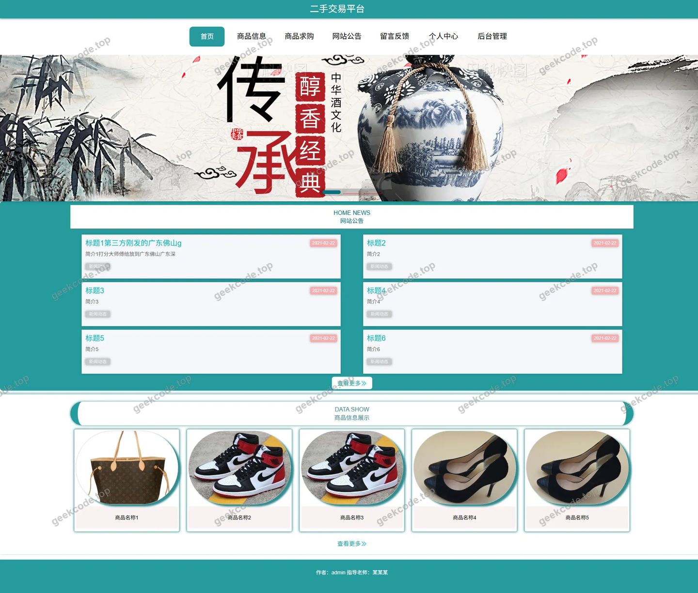</a>

<h4>前台登录页</h4>

<h4>前台注册页</h4>

<a href="https://geekcode.top/archives/%E4%BA%8C%E6%89%8B%E4%BA%A4%E6%98%93%E5%B9%B3%E5%8F%B0?utm_source=github" title="查看完整源码">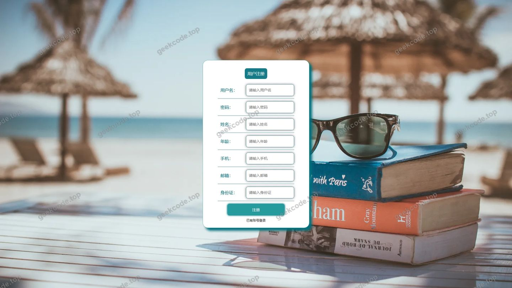</a>

<h4>前台-网站公告列表</h4>

<a href="https://geekcode.top/archives/%E4%BA%8C%E6%89%8B%E4%BA%A4%E6%98%93%E5%B9%B3%E5%8F%B0?utm_source=github" title="查看完整源码">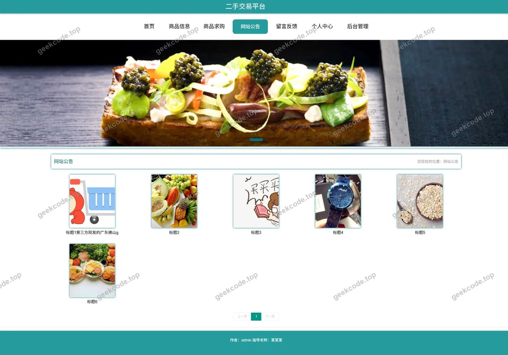</a>

<h4>前台-商品求购列表</h4>

<h4>前台-商品信息列表</h4>

<h4>前台-商品求购评论列表</h4>

<h4>前台-商品信息评论列表</h4>

<h4>前台个人中心</h4>

<a href="https://geekcode.top/archives/%E4%BA%8C%E6%89%8B%E4%BA%A4%E6%98%93%E5%B9%B3%E5%8F%B0?utm_source=github" title="查看完整源码">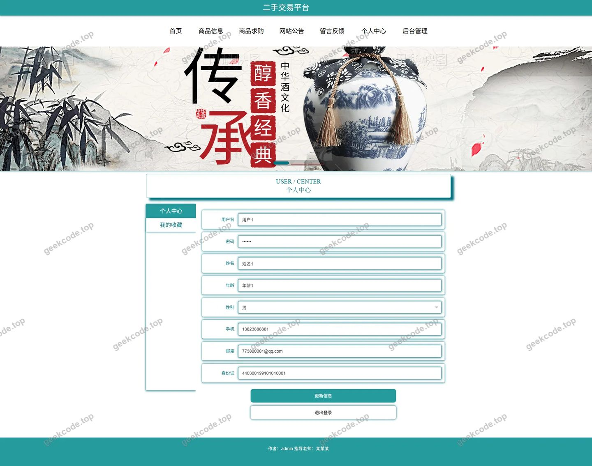</a>

<h4>前台-留言反馈列表</h4>

<h4>前台-我的收藏列表</h4>

<h4>前台-网站公告-详情</h4>

<h4>前台-商品求购-详情</h4>

<a href="https://geekcode.top/archives/%E4%BA%8C%E6%89%8B%E4%BA%A4%E6%98%93%E5%B9%B3%E5%8F%B0?utm_source=github" title="查看完整源码">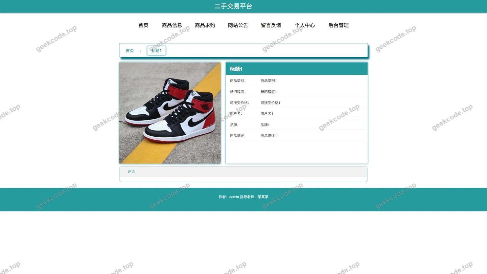</a>

<h4>前台-商品信息-详情</h4>

<a href="https://geekcode.top/archives/%E4%BA%8C%E6%89%8B%E4%BA%A4%E6%98%93%E5%B9%B3%E5%8F%B0?utm_source=github" title="查看完整源码">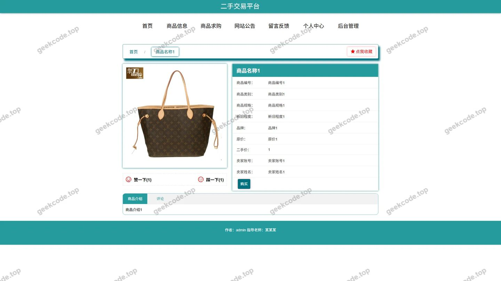</a>

<h4>前台-二手订单列表</h4>

<h4>前台-卖家列表</h4>

<h4>前台-商品分类列表</h4>

<h4>前台-商品求购评论-详情</h4>

<a href="https://geekcode.top/archives/%E4%BA%8C%E6%89%8B%E4%BA%A4%E6%98%93%E5%B9%B3%E5%8F%B0?utm_source=github" title="查看完整源码">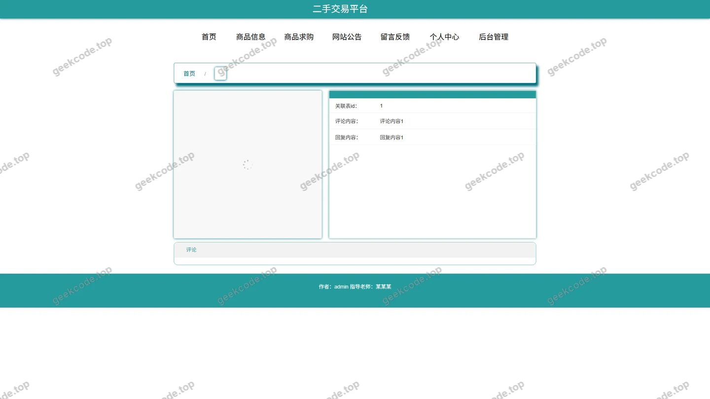</a>

<h4>前台-商品信息评论-详情</h4>

<h4>前台-二手订单-详情</h4>

<a href="https://geekcode.top/archives/%E4%BA%8C%E6%89%8B%E4%BA%A4%E6%98%93%E5%B9%B3%E5%8F%B0?utm_source=github" title="查看完整源码">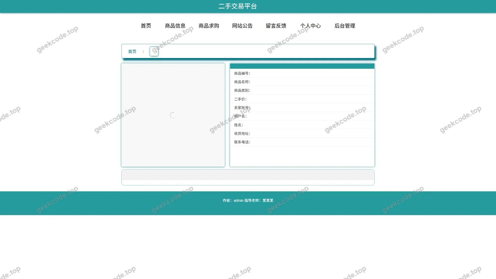</a>

<h4>前台-卖家-详情</h4>

<a href="https://geekcode.top/archives/%E4%BA%8C%E6%89%8B%E4%BA%A4%E6%98%93%E5%B9%B3%E5%8F%B0?utm_source=github" title="查看完整源码">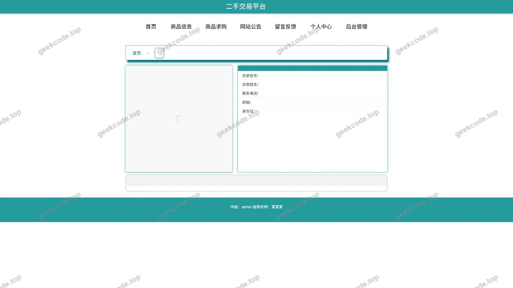</a>

<h3>后台管理端</h3>
<h4>后台-系统配置</h4>

<a href="https://geekcode.top/archives/%E4%BA%8C%E6%89%8B%E4%BA%A4%E6%98%93%E5%B9%B3%E5%8F%B0?utm_source=github" title="查看完整源码">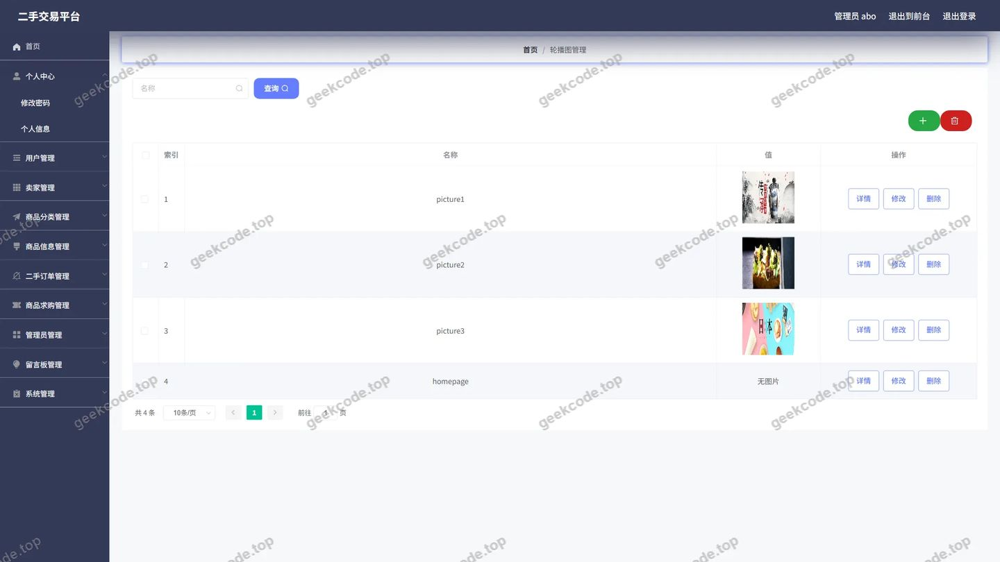</a>

<h4>后台-商品求购评论</h4>

<a href="https://geekcode.top/archives/%E4%BA%8C%E6%89%8B%E4%BA%A4%E6%98%93%E5%B9%B3%E5%8F%B0?utm_source=github" title="查看完整源码">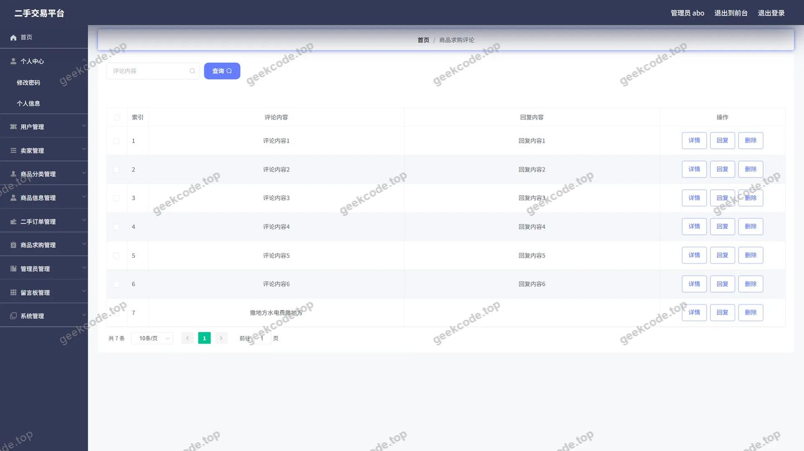</a>

<h4>后台-商品信息评论</h4>

<a href="https://geekcode.top/archives/%E4%BA%8C%E6%89%8B%E4%BA%A4%E6%98%93%E5%B9%B3%E5%8F%B0?utm_source=github" title="查看完整源码">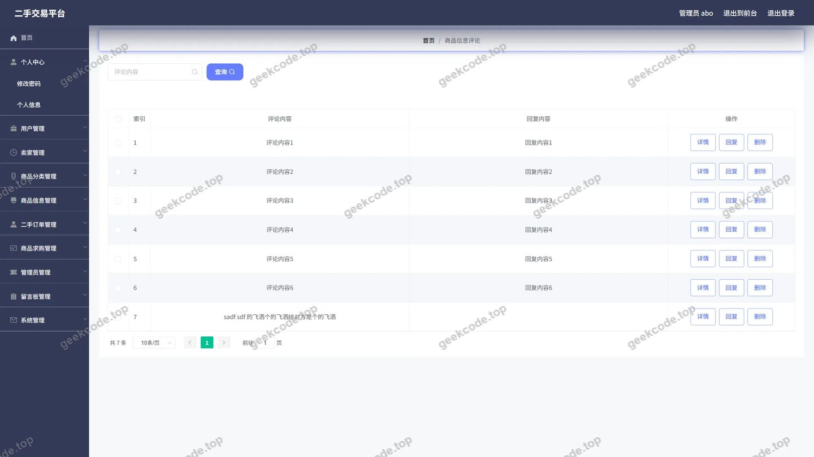</a>

<h4>后台-二手订单</h4>

<a href="https://geekcode.top/archives/%E4%BA%8C%E6%89%8B%E4%BA%A4%E6%98%93%E5%B9%B3%E5%8F%B0?utm_source=github" title="查看完整源码">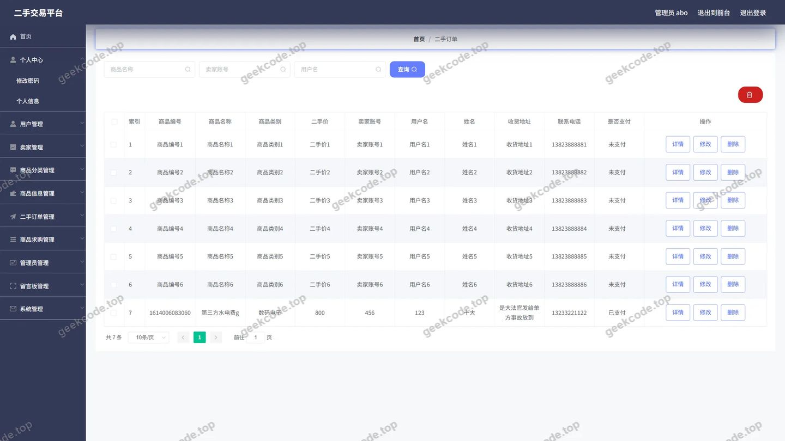</a>

<h4>后台首页</h4>

<a href="https://geekcode.top/archives/%E4%BA%8C%E6%89%8B%E4%BA%A4%E6%98%93%E5%B9%B3%E5%8F%B0?utm_source=github" title="查看完整源码">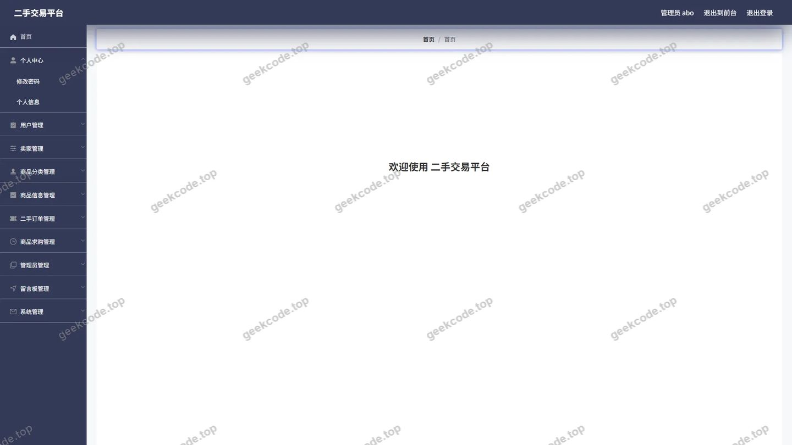</a>

<h4>后台-登录</h4>

<a href="https://geekcode.top/archives/%E4%BA%8C%E6%89%8B%E4%BA%A4%E6%98%93%E5%B9%B3%E5%8F%B0?utm_source=github" title="查看完整源码">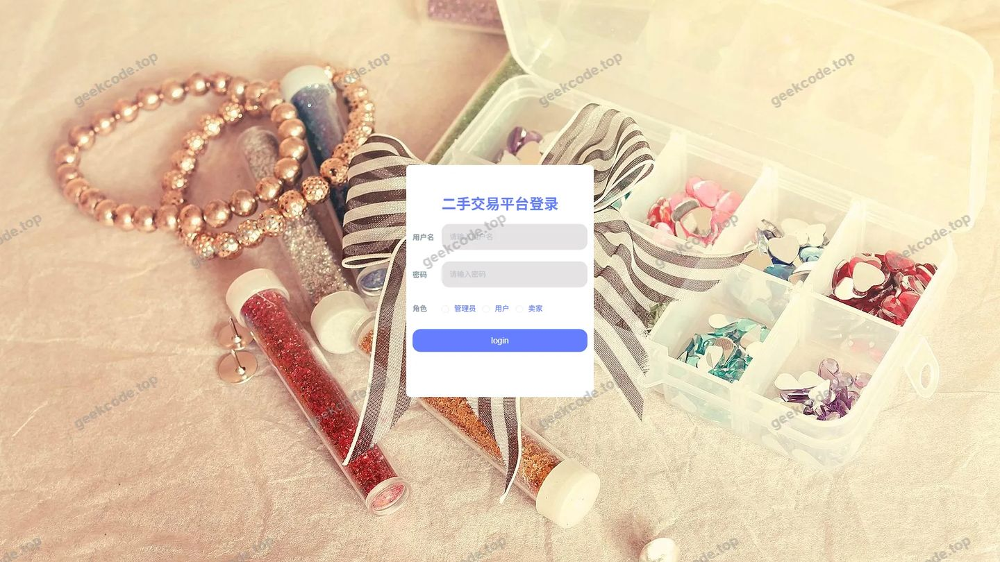</a>

<h4>后台-卖家</h4>

<a href="https://geekcode.top/archives/%E4%BA%8C%E6%89%8B%E4%BA%A4%E6%98%93%E5%B9%B3%E5%8F%B0?utm_source=github" title="查看完整源码">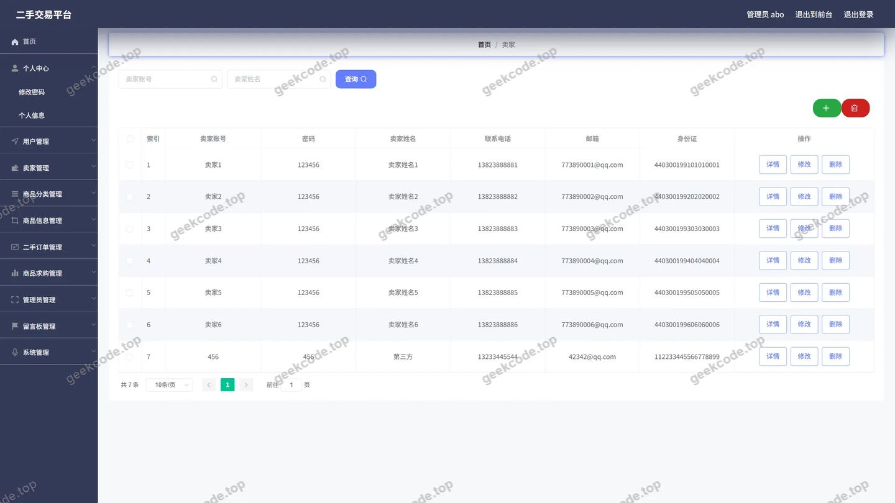</a>

<h4>后台-留言板</h4>

<a href="https://geekcode.top/archives/%E4%BA%8C%E6%89%8B%E4%BA%A4%E6%98%93%E5%B9%B3%E5%8F%B0?utm_source=github" title="查看完整源码">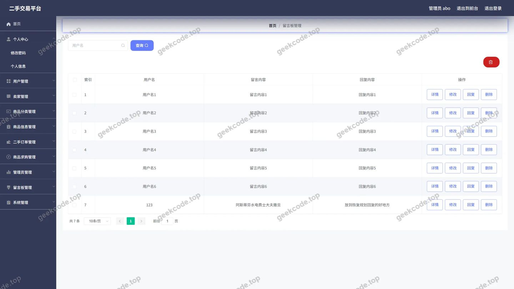</a>

<h4>后台-公告信息</h4>

<a href="https://geekcode.top/archives/%E4%BA%8C%E6%89%8B%E4%BA%A4%E6%98%93%E5%B9%B3%E5%8F%B0?utm_source=github" title="查看完整源码">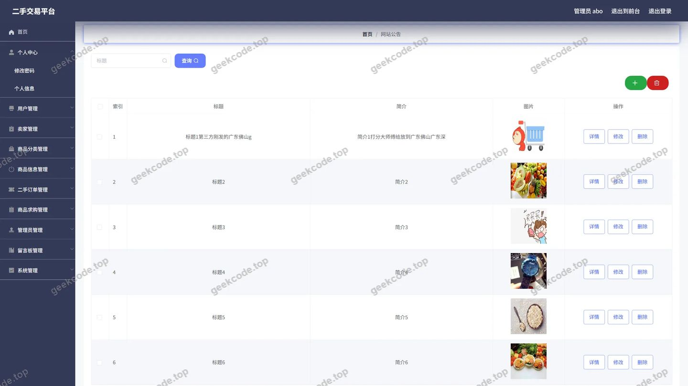</a>

<h4>后台-商品分类</h4>

<a href="https://geekcode.top/archives/%E4%BA%8C%E6%89%8B%E4%BA%A4%E6%98%93%E5%B9%B3%E5%8F%B0?utm_source=github" title="查看完整源码">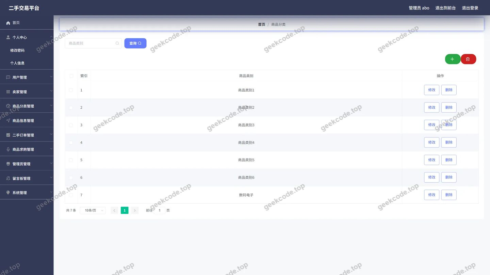</a>

<h4>后台-商品求购</h4>

<a href="https://geekcode.top/archives/%E4%BA%8C%E6%89%8B%E4%BA%A4%E6%98%93%E5%B9%B3%E5%8F%B0?utm_source=github" title="查看完整源码">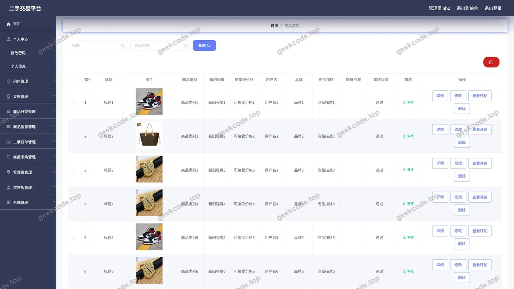</a>

<h4>后台-商品信息</h4>

<a href="https://geekcode.top/archives/%E4%BA%8C%E6%89%8B%E4%BA%A4%E6%98%93%E5%B9%B3%E5%8F%B0?utm_source=github" title="查看完整源码">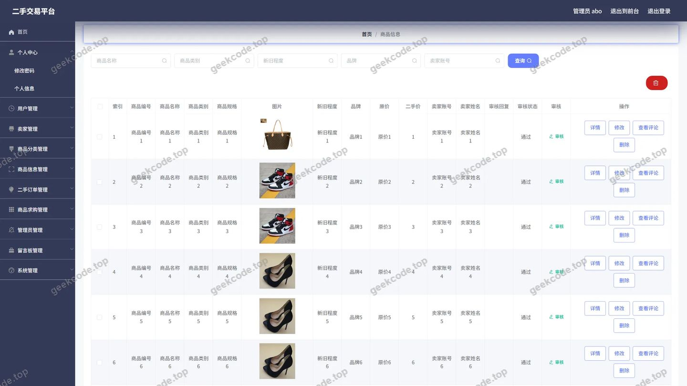</a>

<h4>后台-收藏</h4>

<a href="https://geekcode.top/archives/%E4%BA%8C%E6%89%8B%E4%BA%A4%E6%98%93%E5%B9%B3%E5%8F%B0?utm_source=github" title="查看完整源码">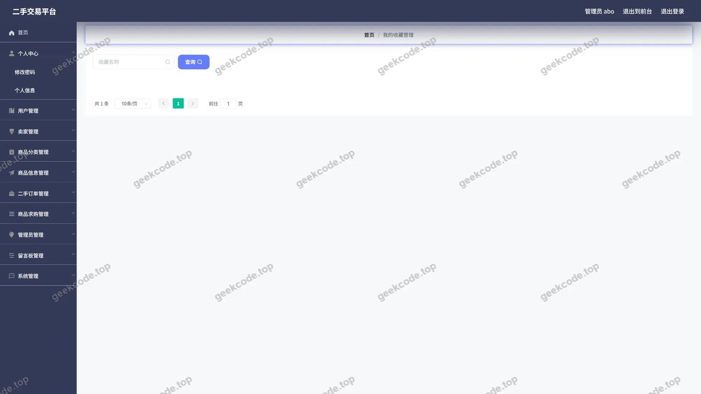</a>

---

## 获取完整源码

| 项目 | 说明 |
| --- | --- |
| 项目名 | 二手交易平台 |
| 运行截图 | 本文 35 张（站点带水印原图，仓库 `images/` 目录） |
| 完整源码 | [https://geekcode.top/archives/%E4%BA%8C%E6%89%8B%E4%BA%A4%E6%98%93%E5%B9%B3%E5%8F%B0?utm_source=github](https://geekcode.top/archives/%E4%BA%8C%E6%89%8B%E4%BA%A4%E6%98%93%E5%B9%B3%E5%8F%B0?utm_source=github) |
| 咨询微信 | **ir9372**（备注：jingpin-yuanma） |
| 更多项目 | [极客代码 geekcode.top](https://geekcode.top/?utm_source=github) |

> 需要源码、部署、改配置、跑不起来等问题，加微信 ir9372 沟通，说明项目名即可。
